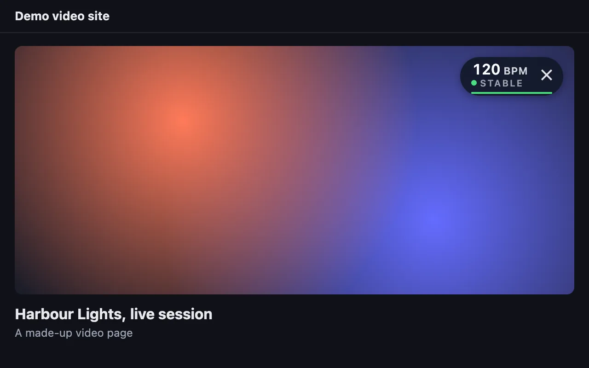
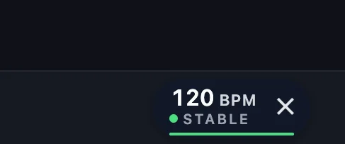
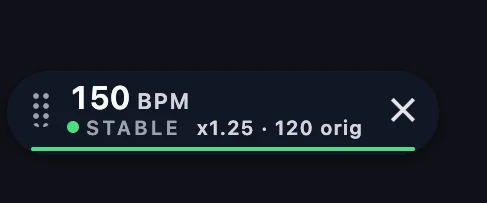
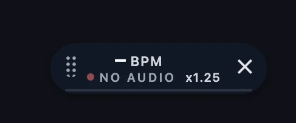

<section class="ext-hero">
  

    <h1>See the BPM of what's playing, right on the player</h1>
    
Live BPM Detector is a browser extension that shows the live tempo of the music playing in the current tab.

    <ExtensionInstall />
  

  
</section>

## How it works

<ol class="ext-howto">
  <li>
    <h3>Add it to Chrome</h3>
    
Chrome's install prompt says "Read and change all your data on all websites" because that is its warning for tab capture. The extension only acts on the tab you click.

  </li>
  <li>
    <h3>Play some music</h3>
    
Open a tab that is playing music.

  </li>
  <li>
    <h3>Click the toolbar button</h3>
    
The BPM appears on top of the page and updates live. Click again, or close the overlay, to stop.

  </li>
</ol>

## What you'll see

  <figure>
    
    <figcaption>On music sites it sits in the play bar.</figcaption>
  </figure>
  <figure>
    
    <figcaption>At x1.25 you see the tempo you hear, and the track's original tempo beside it.</figcaption>
  </figure>
  <figure>
    
    <figcaption>Before it has a tempo, if no sound reaches it, the overlay says "no audio".</figcaption>
  </figure>

These pictures show the real overlay on made-up pages, with example readings. The last three are cropped to the overlay.

## Where it works

  

    <h3>In the player</h3>
    <ul>
      <li>YouTube</li>
      <li>YouTube Music</li>
      <li>Twitch</li>
    </ul>
  

  

    <h3>In the play bar</h3>
    <ul>
      <li>SoundCloud</li>
      <li>Bandcamp</li>
      <li>Mixcloud</li>
    </ul>
  

  

    <h3>Elsewhere</h3>
    
It is usually a floating pill you can drag anywhere.

  

It usually places itself as shown. This extension is independent, and is not affiliated with or endorsed by any of these services.

## What it can't do

- It looks for tempos from 90 to about 178 BPM. Faster music reads at half and slower music at double: 200 shows as 100, 70 as 140.
- It restarts when the page shows that the track changed. On a continuous mix, one-stream radio or a player that shows no track change, it has only the audio to go on, so the old tempo can stay on screen, still marked stable, for about 20 seconds after the music changes. The new tempo can take longer again to settle, and may be wrong at first.
- Stable means the reading has settled, not that it is certainly right.
- Some sites protect their audio. Before it has a tempo, if no sound reaches it, the overlay says "no audio". Once it has one, that number stays on screen through a pause or silence, and a stable one stays marked stable.

## Your audio never leaves your device

When you click the extension's button on a tab, it listens to that tab's audio and works out the tempo on your computer. The audio is not recorded, stored or sent anywhere. Nobody, including us, can hear it or receive it.

The extension makes no network request of its own, contains no analytics and has no account, install id or advertising.

What the extension handles:

- The audio of the tab you chose, analysed on your device, only to show its tempo.
- The page's hostname, its media player and what it says is playing, read on your device to place the overlay, show the playback speed and notice when the track changes. None of this is stored or sent.

The extension opens a page of realtime-bpm-analyzer.com when you install it and after a feature update, and sets one for your browser to open when you remove it. The only thing the extension passes to these pages is its version number, and the previous version after an update, in the address. The pages are part of the website, which uses Google Analytics as described in [Website Privacy](/website-privacy), so a visit to one of them is measured like any other visit.

Read the full [extension privacy policy](/extension/privacy).

## Questions

<ToolFaq />

<section class="ext-closing">
  <h2>Try it on the next track you play</h2>
  <ExtensionInstall />
</section>

Building something of your own? The <a href="/guide/getting-started">open-source library</a> is on this site too.

